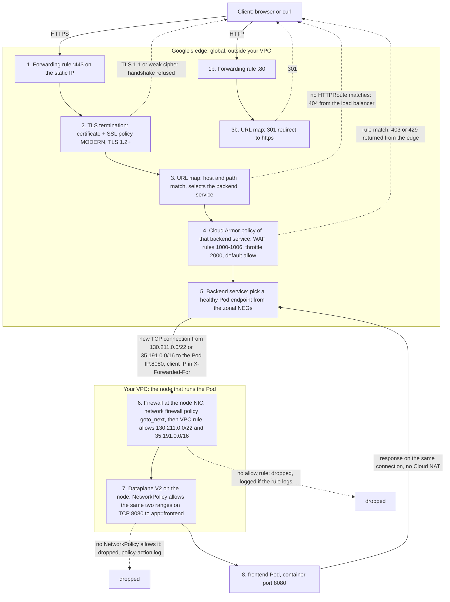
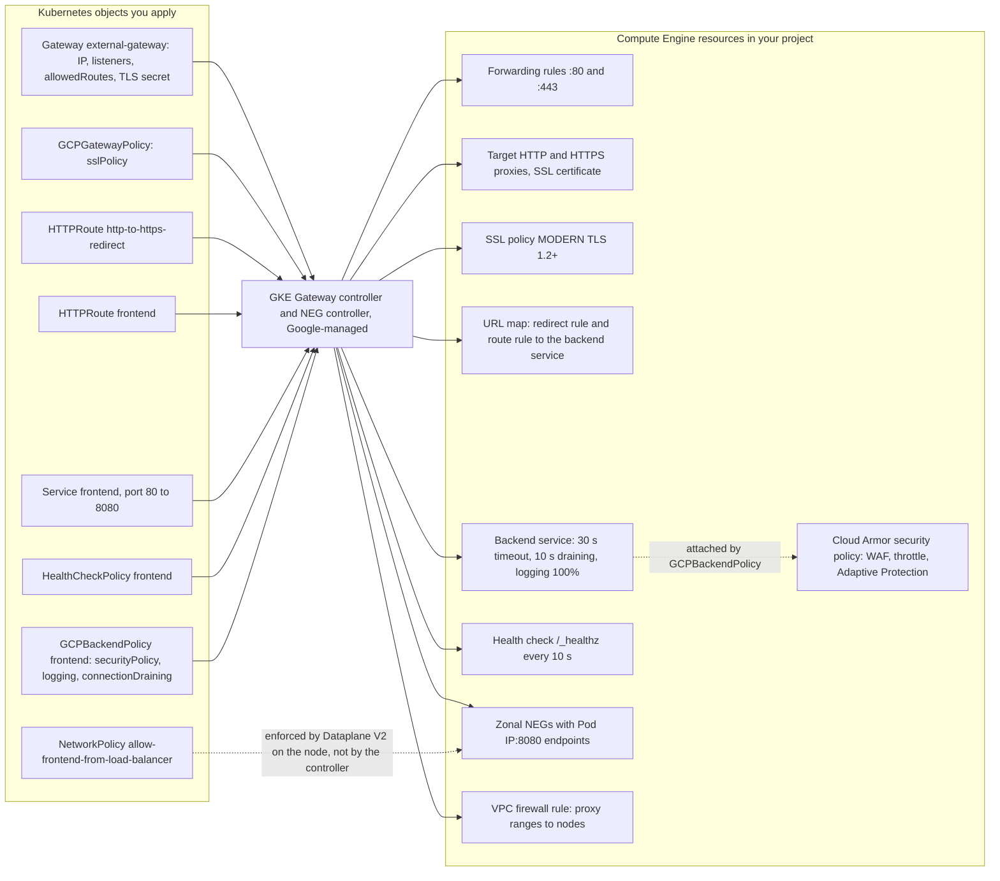

# Ingress Flow: One Request, Every Control It Crosses

A request to `https://${GATEWAY_IP}/` crosses nine stages between the client and the `frontend` container. Each stage is configured by one Kubernetes object, executed by one Google Cloud resource, and leaves evidence in one log. This page follows the request in order, so you can see **where** each control acts and **what** can stop the request there.

Everything here is created in Labs 02–06; the "Lab" column says where.

## The data path



Two things the picture makes visible:

- **Stages 1–5 run before a single packet enters your VPC.** TLS errors, 404s, WAF blocks and rate limits never reach a node, never appear in firewall or NAT logs, and don't consume cluster capacity.
- **Stages 6 and 7 are both enforced on the node that runs the Pod**, by two different systems: the VPC firewall at the virtual NIC (Google's SDN), then Cilium eBPF inside the node (Dataplane V2). The load balancer talks to the **Pod IP**, not to a node port: with container-native load balancing there is no kube-proxy hop and no in-cluster ingress controller.

## Stage by stage

| # | What happens | Kubernetes object | Google Cloud resource it becomes | Lab | Can stop the request? | Evidence |
|---|---|---|---|---|---|---|
| 1 | The anycast IP answers at the nearest Google edge location (Premium Tier) | `Gateway` `external-gateway`: `spec.addresses` (`NamedAddress` → `${GATEWAY_IP_NAME}`), listeners `http` :80 and `https` :443 | Two global forwarding rules on `${GATEWAY_IP}`, one per listener | 02 (IP), 04 (Gateway) | No | `gcloud compute forwarding-rules list --global` (see *Inspect*, stage 1) |
| 2 | TLS handshake: the certificate from the `shop-tls` Secret is presented; the SSL policy decides which TLS versions and ciphers are accepted | `Gateway` listener `https` (`tls.certificateRefs`) and `GCPGatewayPolicy` (`sslPolicy: ${SSL_POLICY}`) | Target HTTPS proxy with a Compute Engine SSL certificate and the SSL policy `MODERN` / min TLS 1.2 | 04 | Yes: clients below TLS 1.2 or with weak ciphers are refused during the handshake (Lab 04, step 11) | `openssl s_client` output; no HTTP request and no load balancer log entry exist yet. Configuration: *Inspect*, stage 2 |
| 3 | The URL map matches host and path and selects a backend service | `HTTPRoute` `frontend` (namespace `onlineboutique`, parent `external-gateway`, section `https`, backend `Service frontend:80`). The Gateway's `allowedRoutes` decides which namespaces may attach (label `gateway-access: "true"`) | URL map with one host rule (`*`) and a route rule `prefix /` → the frontend backend service | 05 | Yes: a request no route matches gets `404` from the load balancer (what you saw in Lab 04 before Lab 05) | `kubectl get httproute -n onlineboutique frontend -o yaml` (status `Accepted`, `ResolvedRefs`); the URL map itself: *Inspect*, stage 3 |
| 3b | On the HTTP listener, the URL map returns a redirect instead of selecting a backend | `HTTPRoute` `http-to-https-redirect` (`RequestRedirect`, scheme `https`, 301) | Target HTTP proxy + URL map with `httpsRedirect` | 04 | Ends the request with `301`; no backend service, so no Cloud Armor evaluation | `curl -I http://${GATEWAY_IP}/`; load balancer log entry with `statusDetails: cloud_redirect` |
| 4 | The Cloud Armor security policy **attached to the selected backend service** is evaluated, rules in priority order, first match wins | `GCPBackendPolicy` `frontend` (`securityPolicy: ${ARMOR_POLICY}`) | Backend service → security policy `${ARMOR_POLICY}`: `1000`–`1006` OWASP CRS 4.22 (`deny-403`), `2000` throttle `/product/` 30 requests/minute per client IP (`deny-429`), `2147483647` default `allow`; Adaptive Protection; verbose logging; JSON parsing | 04 (policy), 05 (attachment), 06 (enforce) | Yes: `403` or `429` is returned from the edge. Rules in preview mode log the decision but don't block | Load balancer logs: `jsonPayload.enforcedSecurityPolicy` (or `previewSecurityPolicy`); the rules: *Inspect*, stage 4 |
| 5 | The backend service picks a healthy endpoint and opens a **new TCP connection** from a Google proxy address (`130.211.0.0/22` or `35.191.0.0/16`) to the Pod IP on the container port. The client IP travels in `X-Forwarded-For` | `Service` `frontend` (selector `app=frontend`, port 80 → 8080): the Gateway controller annotates it with `cloud.google.com/neg`, and the NEG controller fills one NEG per zone with Pod IP:8080 endpoints. `HealthCheckPolicy` `frontend`. `GCPBackendPolicy` `logging` and `connectionDraining` | Backend service (`EXTERNAL_MANAGED`, HTTP, `timeoutSec` 30, `connectionDraining` 10 s, logs at 100%) with three zonal NEGs (`GCE_VM_IP_PORT`), balancing mode `RATE`; health check HTTP `/_healthz` on the serving port, every 10 s, 5 s timeout, 1 healthy / 3 unhealthy. Health checks come from the same two ranges | 05 | Yes: no healthy endpoint → `502`/`503`; backend slower than 30 s → `504` | Endpoint health per Pod IP: *Inspect*, stage 5 |
| 6 | The packet arrives at the node's virtual NIC. VPC firewall evaluation, in this order (enforcement order `BEFORE_CLASSIC_FIREWALL`): hierarchical policies (none), the network firewall policy `${FW_POLICY_NAME}` (its rules `1000`/`2000` are egress-only; the predefined ingress rules say `goto_next`), then VPC firewall rules | None of yours. GKE created the VPC rule when the Gateway was programmed | VPC firewall rule `gkegw1-<id>-l7-${VPC_NAME}-global`: ingress from `130.211.0.0/22` and `35.191.0.0/16`, TCP all ports, all instances in the VPC. (GKE's `gke-<cluster>-all` and `-vms` rules cover Pod-to-Pod and node-to-node traffic) | 02 (policy), 04 (rule appears) | Yes, in principle: without the rule the implied deny-ingress drops the packet. In this design it always passes | Firewall Rules Logging, if enabled on the rule (not enabled on GKE's rules); the effective rule set: *Inspect*, stage 6 |
| 7 | Inside the node, Dataplane V2 (Cilium eBPF) applies the NetworkPolicies that select the destination Pod | `NetworkPolicy` `default-deny-all` + `allow-frontend-from-load-balancer` in `onlineboutique` (`ipBlock` `35.191.0.0/16` and `130.211.0.0/22`, TCP 8080, `podSelector app=frontend`) | Cilium policy on the node | 04 (deny baseline), 05 (allow rule) | Yes: without the allow rule the SYN is dropped, health checks fail, and the load balancer answers `502`/`503` | `policy-action` logs in Cloud Logging (denied connections, Lab 04 step 5), `hubble observe --verdict DROPPED` |
| 8 | The `frontend` container accepts the connection on 8080 and answers. The response goes back on the same connection, through the proxy, to the client. Cloud NAT is not involved | `Deployment` `frontend` (`preStop` sleep 20 s keeps it serving while the load balancer drains it) | The Pod | 05 | Application errors (`500`) come from here | Container logs (`resource.type="k8s_container"`), load balancer logs (`httpRequest.status`, `statusDetails`): *Inspect*, stage 8 |

## Who configures what



The SSL policy (`gcloud compute ssl-policies create`, Lab 04 step 7) and the Cloud Armor policy (Lab 04 step 8) are created by you with `gcloud`; the Kubernetes policies only **reference** them by name. Everything else in the right-hand box is created and deleted by the controller, which is why the cleanup deletes the Gateway first and waits for the forwarding rules to disappear.

## What each control does not do

1. **The Cloud NGFW policy from Lab 02 doesn't filter this traffic.** Its rules are egress rules. For ingress it says `goto_next`, and the GKE-created VPC rule admits the proxy ranges on every TCP port. The narrowing to port 8080 on `frontend` Pods is done by the NetworkPolicy (stage 7), so the two layers together are what makes "only the load balancer, only port 8080" true.
2. **`GCPGatewayPolicy` and `GCPBackendPolicy` act on different ends of the proxy.** The Gateway policy shapes the client-facing side (TLS) for every route on the Gateway; the backend policy shapes one Service's backend (WAF, logging, draining). Two applications on the same Gateway can have different Cloud Armor policies.
3. **Cloud Armor can't see the client's TCP connection from inside the VPC.** It runs at the edge; the Pod sees a connection from a proxy address and the real client IP only in `X-Forwarded-For`. That's why the NetworkPolicy allows the proxy ranges, not client ranges, and why IP-based blocking belongs in Cloud Armor (Lab 06, "Block a specific client").
4. **Cloud NAT and the static NAT IP play no role in ingress.** They serve outbound connections that Pods start. Responses to load-balanced requests return over the proxy's connection.
5. **The `Service` is not a hop.** It only tells the NEG controller which Pods and which port belong in the NEGs. `ClusterIP` and kube-proxy are bypassed by container-native load balancing; the health check and the traffic target `targetPort` 8080 directly.

## Reading a failure from the symptom

| Symptom at the client | Stage | First thing to check |
|---|---|---|
| TLS handshake error, `alert protocol version` | 2 | The client's TLS version against the SSL policy (`gcloud compute ssl-policies describe ${SSL_POLICY}`) |
| `404` from the load balancer, no app page | 3 | `kubectl get httproute -A`: is the route `Accepted`, does the namespace carry `gateway-access: "true"`, did the edge finish propagating (up to 10 minutes) |
| `403` or `429` on specific requests | 4 | Load balancer logs, `jsonPayload.enforcedSecurityPolicy.priority` and `preconfiguredExprIds` (Lab 06, "Investigate blocked requests") |
| `502`/`503` on every request | 5–7 | `gcloud compute backend-services get-health`; NEG endpoints present; Pod `Ready`; `HealthCheckPolicy` path `/_healthz`; `policy-action` logs for denied `8080` from `130.211.0.0/22` or `35.191.0.0/16` |
| `504` or 30-second stalls | 5, 8 | Backend service `timeoutSec` (30 s) against the application's latency |
| `500` with an app error message | 8 | Container logs of `frontend` and the backend it called; in this workshop often a missing `allow-dns-egress` policy |

## Inspect every stage with gcloud

Stages 1–6 exist only as Compute Engine resources in your project; `kubectl` shows the intent, `gcloud` shows what Google's edge is enforcing. The controller generates the resource names (`gkegw1-<id>-…`), so the commands find them by filter. Run them after `source ./env.sh`.

### Stage 1: forwarding rules and the static IP

```bash
gcloud compute addresses describe "${GATEWAY_IP_NAME}" --global \
  --format="table(address,status,networkTier,users.map().basename().list())"
gcloud compute forwarding-rules list --global --filter="IPAddress=${GATEWAY_IP}" \
  --format="table(name,IPAddress,portRange,networkTier,loadBalancingScheme,target.basename())"
```

Expect `status: IN_USE`, two rules (`80-80` and `443-443`), `PREMIUM`, `EXTERNAL_MANAGED`. The `target` is the HTTP or HTTPS proxy of stage 2.

### Stage 2: TLS, certificate and SSL policy

```bash
gcloud compute target-https-proxies list \
  --format="table(name,sslPolicy.basename(),sslCertificates.map().basename().list(),urlMap.basename())"
gcloud compute ssl-policies describe "${SSL_POLICY}" --format="yaml(profile,minTlsVersion,enabledFeatures)"
gcloud compute ssl-certificates list --format="table(name,type,expireTime,subjectAlternativeNames.list())"
```

`enabledFeatures` is the cipher list the `MODERN` profile allows. The certificate is `SELF_MANAGED` (uploaded from the `shop-tls` Secret), with `shop.example.com` as its only subject alternative name.

### Stage 3: URL maps

```bash
for M in $(gcloud compute url-maps list --filter="name~gateway-infra-external-gateway" --format="value(name)"); do
  echo "== ${M}"
  gcloud compute url-maps describe "${M}" --format="yaml(hostRules,pathMatchers)"
done
```

Two maps: the HTTP one has a `routeRules` entry with `urlRedirect.httpsRedirect: true`; the HTTPS one routes `prefixMatch: /` to `weightedBackendServices` → the `onlineboutique-frontend-80` backend service. A host rule of `*` means the `HTTPRoute` sets no `hostnames`.

### Stage 4: Cloud Armor

```bash
gcloud compute security-policies describe "${ARMOR_POLICY}" --flatten="rules[]" \
  --format="table(rules.priority,rules.action,rules.preview,rules.match.expr.expression,rules.rateLimitOptions.rateLimitThreshold.count,rules.description)"
gcloud compute security-policies describe "${ARMOR_POLICY}" --format="yaml(adaptiveProtectionConfig,advancedOptionsConfig)"
gcloud compute backend-services list --global --filter="securityPolicy:${ARMOR_POLICY}" \
  --format="table(name,securityPolicy.basename())"
```

The first command is the evaluation order: lowest priority number first, `2147483647` (`allow`) last. `preview: True` means log only. The third command proves the policy is attached to the frontend's backend service; a policy that is attached to nothing evaluates nothing.

### Stage 5: backend service, health check, NEGs

```bash
gcloud compute backend-services list --global --filter="name~onlineboutique-frontend" \
  --format="table(name,protocol,loadBalancingScheme,timeoutSec,connectionDraining.drainingTimeoutSec,logConfig.sampleRate,backends[].group.map().basename().list())"
gcloud compute health-checks list --filter="name~onlineboutique-frontend" \
  --format="table(name,type,httpHealthCheck.requestPath,httpHealthCheck.portSpecification,checkIntervalSec,timeoutSec,healthyThreshold,unhealthyThreshold)"
gcloud compute network-endpoint-groups list --filter="name~onlineboutique-frontend" \
  --format="table(name,zone.basename(),networkEndpointType,size)"
```

Then the endpoints themselves, with the health the load balancer sees for each Pod IP (`get-health` asks the load balancer; the NEG listing alone doesn't carry health):

```bash
BACKEND_SERVICE="$(gcloud compute backend-services list --global --filter="name~onlineboutique-frontend" --format="value(name)")"
gcloud compute backend-services get-health "${BACKEND_SERVICE}" --global \
  --format="table(backend.basename():label=NEG,status.healthStatus[].ipAddress.list():label=ENDPOINT_IPS,status.healthStatus[].port.list():label=PORTS,status.healthStatus[].healthState.list():label=HEALTH)"
```

One row per zonal NEG; zones without a frontend Pod show an empty row. The IP addresses are Pod IPs from the `10.20.0.0/16` range, port `8080`. Compare with `kubectl get pods -n onlineboutique -l app=frontend -o wide`. `HEALTHY` means the health check from `130.211.0.0/22` / `35.191.0.0/16` got through stages 6 and 7.

### Stage 6: the firewall at the node

```bash
gcloud compute networks describe "${VPC_NAME}" --format="value(networkFirewallPolicyEnforcementOrder)"
gcloud compute network-firewall-policies describe "${FW_POLICY_NAME}" --global --flatten="rules[]" \
  --format="table(rules.priority,rules.direction,rules.action,rules.match.srcIpRanges.list(),rules.match.destIpRanges.list())"
gcloud compute firewall-rules list --filter="network~${VPC_NAME} AND name~^gkegw1-" \
  --format="table(name,direction,priority,sourceRanges.list(),allowed[].map().firewall_rule().list(),targetTags.list())"
gcloud compute networks get-effective-firewalls "${VPC_NAME}"
```

In order: `BEFORE_CLASSIC_FIREWALL`; the policy's only `INGRESS` rows are the predefined `goto_next` rules (priorities `2147483645` and `2147483647`), everything you wrote is `EGRESS`; the GKE-created VPC rule allows `130.211.0.0/22,35.191.0.0/16` on `tcp:0-65535` with no target tags; the last command merges all layers in evaluation order (policy rows first, then the `network-firewall` rows).

### Stage 7: Dataplane V2 network policy

This stage runs inside the cluster, so `kubectl` shows the configuration and Cloud Logging shows the enforcement:

```bash
kubectl get networkpolicy -n onlineboutique allow-frontend-from-load-balancer -o yaml
gcloud logging read --freshness=1h --limit=5 \
  'resource.type="k8s_node" AND log_id("policy-action") AND jsonPayload.disposition="deny" AND jsonPayload.dest.namespace="onlineboutique" AND jsonPayload.connection.dest_port=8080' \
  --format="table(timestamp.date('%H:%M:%S'):label=TIME,jsonPayload.src.pod_name:label=SRC_POD,jsonPayload.connection.src_ip:label=SRC_IP,jsonPayload.dest.pod_name:label=DEST_POD)"
```

An empty result is the healthy state: nothing from the proxy ranges is being dropped. If the allow policy is missing, the source IPs in this list fall inside `130.211.0.0/22` or `35.191.0.0/16`.

### Stage 8 and the whole path: load balancer logs

Every request that reaches stage 3 or later produces one load balancer log entry. `statusDetails` names the stage that produced the response, so one query tells you where a request ended:

```bash
gcloud logging read --freshness=30m --limit=10 \
  'resource.type="http_load_balancer" AND httpRequest.requestUrl:"'"${GATEWAY_IP}"'"' \
  --format="table(timestamp.date('%H:%M:%S'):label=TIME,httpRequest.remoteIp:label=CLIENT,httpRequest.requestMethod:label=METHOD,httpRequest.status:label=STATUS,httpRequest.latency:label=LATENCY,jsonPayload.statusDetails:label=STATUS_DETAILS,jsonPayload.enforcedSecurityPolicy.outcome:label=ARMOR)"
```

| `statusDetails` | Stage that answered |
|---|---|
| `response_sent_by_backend` | 8: the Pod answered; `STATUS` is the application's status code |
| `cloud_redirect` | 3b: the URL map's HTTP-to-HTTPS redirect (`STATUS` 301, `ARMOR` empty because no backend service was involved) |
| `denied_by_security_policy` | 4: Cloud Armor; `ARMOR` shows `DENY` and the rule priority is in `enforcedSecurityPolicy.priority` |
| `failed_to_pick_backend` | 5: no healthy endpoint in any NEG (health check failing, often because stage 7 drops it) |
| `failed_to_connect_to_backend` | 6–7: the endpoint exists but the TCP connection to the Pod failed |
| `backend_timeout` | 5: no response within the backend service's 30 seconds |

Stages 1 and 2 leave no load balancer log entry: a refused TLS handshake never becomes an HTTP request. The only evidence is on the client side (`openssl s_client`, Lab 04 step 11).
