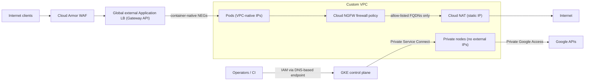

# Network Design for a Production GKE Cluster

Several network design decisions and trade-offs need to be evaluated. Each section below follows the same format: objectives, assumptions, the key decisions, and the technologies used.

## What is your IP address plan?

Objectives:

- Decide on the VPC, subnets and IP ranges for nodes, Pods and Services.
- Leave room for growth, upgrades and other clusters.

Assumptions:

- The cluster is **VPC-native** (the default): Pods and Services get IP addresses from secondary ranges of the node subnet, and Pod IPs are routable in the VPC.
- The ranges must not overlap with on-premises or peered networks.

Key decisions:

- Size the **node** range for the maximum number of nodes, plus surge or blue-green upgrade headroom.
- Size the **Pod** range: GKE allocates a range per node twice the size of the maximum Pods per node (110 Pods by default needs a /24 per node). A /16 Pod range therefore supports 256 nodes. Lowering the maximum Pods per node saves addresses.
- Size the **Service** range for the number of ClusterIP Services.
- In larger organizations, use **Shared VPC**: a central network team owns the network in a host project, and clusters live in service projects.
- If private address space is scarce, GKE supports non-RFC 1918 ranges (for example `100.64.0.0/10`) for Pods.

Technologies used:

- Custom-mode VPC, subnet secondary ranges, VPC Flow Logs

Workshop values: nodes `10.10.0.0/24`, Pods `10.20.0.0/16`, Services `10.30.0.0/20`.

## Who can reach the control plane?

Objectives:

- Prevent unwanted access to the Kubernetes API server.
- Let administrators and CI/CD systems in without fragile IP allow-lists or bastion hosts.

Assumptions:

- Operators work from changing locations (Cloud Shell, home, office).
- The organization may use VPC Service Controls.

Key decisions. Every GKE control plane can expose:

| Endpoint | Access control | Notes |
|---|---|---|
| **DNS-based endpoint** (`*.gke.goog`) | IAM (`container.clusters.connect`), optionally VPC Service Controls | Reachable from anywhere Google APIs are reachable. No bastion or allow-list needed. **Recommended as the only endpoint.** |
| Internal IP endpoint | Authorized networks (CIDR allow-list) | Reachable from the VPC and connected networks. Remote access needs VPN, Interconnect or a bastion. |
| External IP endpoint | Authorized networks (CIDR allow-list) | Reachable from the internet. Allow-lists must be maintained for dynamic IPs. |

GKE's hardening guide recommends using **only the DNS-based endpoint** and disabling the IP-based endpoints. GKE can also block the API server's **outbound** traffic (`--control-plane-egress=NONE`), which prevents data exfiltration through admission webhooks with external URLs. The workshop doesn't use it: the mode blocks all egress, Google APIs included, and GKE enforces Binary Authorization through a fail-open webhook that calls the Binary Authorization service. With egress blocked, every image would be admitted silently. Choose one or the other: `NONE` for clusters that don't enforce Binary Authorization, the default egress mode for clusters that do (see [control plane protection](SecurityDesign.md#control-plane-protection)).

Technologies used:

- DNS-based endpoint, IAM, Private Service Connect (control plane to nodes)

## Should the nodes be reachable from the internet?

Objectives:

- Remove the nodes from the internet's reach.
- Still allow controlled outbound access when needed.

Assumptions:

- Nodes don't need to receive traffic from the internet; load balancers send it to the Pods.
- Many organizations enforce the `compute.vmExternalIpAccess` organization policy, which blocks VMs (including GKE nodes) with external IPs. See [organization guardrails](SecurityDesign.md#organization-guardrails).

Key decisions:

- **Private nodes** have only internal IP addresses.
- **Private Google Access** lets them reach Google APIs (Artifact Registry, Cloud Logging and others) without internet access.
- **Cloud NAT** gives them outbound internet access. A reserved static NAT IP lets partners allow-list your egress traffic.

Technologies used:

- Private nodes, Private Google Access, Cloud Router, Cloud NAT

## Do you want to lock down egress traffic?

Objectives:

- Decide which internet destinations the cluster may reach.
- Make every allowed and denied connection auditable.

Assumptions:

- All egress from nodes and Pods must be filtered.
- A process exists to maintain the list of approved external dependencies.

Key decisions:

- **Cluster-wide:** a Cloud NGFW **network firewall policy** attached to the VPC. It allows HTTPS to an allow-list of domain names (FQDN objects; in the workshop `ifconfig.me` and `api.github.com`, set in `env.sh`) and denies all other traffic in the `INTERNET` network context, with logging. Traffic to Google APIs is in the `NON_INTERNET` context, so it is not affected by the deny rule. The policy is enforced on every VM's network interface, so no firewall appliance, custom routes or traffic steering are needed.
- **Evaluation order:** set the VPC's enforcement order to `BEFORE_CLASSIC_FIREWALL`, so the policy is evaluated before VPC firewall rules and a VPC egress-allow rule can't bypass the deny. Project owners can still change that order or edit the policy. The form they can't change is a **hierarchical firewall policy** at the folder or organization level, which is evaluated first and is managed by the central network team.
- **Google APIs stay reachable, from every Pod, in every project.** The `NON_INTERNET` exemption keeps GKE working, but it also means a compromised Pod can call `storage.googleapis.com` or any other Google API and move data to a project you don't control (Lab 04, test 4, shows the call succeeding). Closing this is the job of [VPC Service Controls](#do-you-need-to-stop-data-exfiltration-through-google-apis), not of the firewall.
- **Per workload:** **FQDN network policies** allow each workload only the domains it needs.
- **Alternatives:** Secure Web Proxy for an explicit or transparent proxy with URL filtering; Cloud NGFW Enterprise for intrusion prevention and TLS inspection.

FQDN objects are not a proxy: they don't inspect the HTTP host or TLS SNI of a connection. Cloud NGFW resolves each name with Cloud DNS and programs the resulting addresses into the rule, with these limits:

| FQDN object property | Value |
|---|---|
| Addresses programmed per name | 32 IPv4 and 32 IPv6 |
| Wildcards | Not supported |
| Record TTL | Avoid names with a TTL under 90 seconds |
| CDN-backed names | May not be fully covered, because the resolved set changes faster than the rule |
| Tier | Cloud NGFW Standard, billed per GiB of evaluated traffic |

For a real approved-destination list with SaaS behind CDNs or wildcard domains, **Secure Web Proxy** is the closer equivalent: it matches on host, SNI or URL, supports wildcards and optional TLS inspection, and can run transparently as a next hop through policy-based routes. It is regional and handles HTTP(S) and TCP only.

Technologies used:

- Cloud NGFW Standard (FQDN objects, network contexts, enforcement order), Firewall Rules Logging, GKE FQDN network policy

## Do you want to lock down ingress traffic?

Objectives:

- Decide how traffic reaches applications, and where TLS is terminated.
- Protect applications from common web attacks and abuse.

Assumptions:

- The storefront is public and must be protected from OWASP Top 10 attacks.
- The platform team owns the load balancer; application teams own their routes.

Key decisions:

- **Gateway API** (recommended) or the older **Ingress** API. Gateway separates the platform team's Gateway from the application teams' HTTPRoutes and supports advanced routing.
- **Global external Application Load Balancer** (`gke-l7-global-external-managed`) for internet traffic; regional external or internal Gateways for regional or private applications. These need a proxy-only subnet.
- **Container-native load balancing:** the load balancer sends traffic directly to Pod IPs through network endpoint groups (NEGs). Unlike designs that put a cloud load balancer in front of an in-cluster proxy (for example an NGINX ingress controller), **no in-cluster ingress controller is needed**: there is one less hop, and nothing to scale, patch or protect inside the cluster.
- **TLS:** Google-managed certificates through Certificate Manager in production (requires a domain), or self-signed and self-managed certificates. An SSL policy enforces TLS 1.2+ with modern ciphers. HTTP is redirected to HTTPS.
- **Cloud Armor** at Google's edge: preconfigured OWASP CRS 4.22 WAF rules, rate limiting, IP and geo rules, Adaptive Protection (layer-7 DDoS detection).

Technologies used:

- GKE Gateway controller, Cloud Load Balancing, Cloud Armor, SSL policies, Certificate Manager

[Ingress flow](IngressFlow.md) follows one request through all of these, stage by stage: forwarding rule, TLS and SSL policy, URL map, Cloud Armor, backend service and NEGs, the VPC firewall at the node, Dataplane V2 network policy, Pod.

## Do you want to isolate workloads from each other?

Objectives:

- Prevent a compromised Pod from reaching other teams' services (lateral movement).

Assumptions:

- Several teams share the cluster.
- Kubernetes allows all Pod-to-Pod traffic by default.

Key decisions:

- **GKE Dataplane V2** (eBPF/Cilium) enforces Kubernetes NetworkPolicies natively and can **log** allowed and denied connections.
- Start every namespace with **default deny** (ingress and egress), then open only what each application needs (DNS, same-namespace traffic, load balancer health checks).
- A service mesh (Cloud Service Mesh) adds mTLS and layer-7 authorization if needed.
- **Cluster DNS:** Google recommends **Cloud DNS for GKE** over kube-dns (no DNS Pods to scale, and Service names resolvable from the VPC). The workshop cluster keeps kube-dns with NodeLocal DNSCache, so its network policies allow DNS to the `kube-dns` and `node-local-dns` Pods; switching to Cloud DNS changes those rules, which is why it stays a design note here.

Technologies used:

- Dataplane V2, Kubernetes NetworkPolicy, network policy logging

## Do you need to stop data exfiltration through Google APIs?

Objectives:

- Make sure the data held by Google Cloud services (container images, secrets, keys, logs, backups) can only be used from inside your environment, even by someone who has stolen valid credentials.
- Add a context-aware check (network origin, device) to control plane access, on top of IAM.

Assumptions:

- The customer is regulated, and stolen credentials or a malicious insider are realistic threats.
- A central security team administers Access Context Manager for the whole organization.

Key decisions:

- **VPC Service Controls** place the platform's projects inside a **service perimeter**. Requests to the restricted Google APIs that cross the perimeter boundary are denied, even with valid credentials, and recorded in Policy Denied audit logs. For example: copying an image or a secret to a project outside the perimeter, or calling the API from the internet without an approved access level.
- Restrict at least the APIs the platform uses: the GKE API (`container.googleapis.com`, together with `kubernetesmetadata.googleapis.com`; this also protects the DNS-based control plane endpoint), Artifact Registry, Secret Manager, Cloud KMS, Cloud Logging, Cloud Monitoring, Cloud Storage, Binary Authorization, Container Analysis, Backup for GKE, Pub/Sub and Cloud Build. GKE also depends on Compute Engine and the Autoscaling API.
- Point private nodes at the **`restricted.googleapis.com`** virtual IP range (`199.36.153.4/30`) with a Cloud DNS private zone (for `googleapis.com` and `pkg.dev`), so they can reach only APIs that VPC Service Controls supports.
- Let operators in with **access levels or ingress rules**: Cloud Shell and laptops are outside the perimeter, so `kubectl` through the DNS-based endpoint and `gcloud` need an access level (for example corporate IP ranges or managed devices) or an ingress rule for the administrators' group.
- Allow what the platform legitimately reads from outside with **egress rules**, for example the public registries that the image mirror copies from.
- Roll out in **dry-run mode** first, review the requests that would be denied in the Policy Denied audit logs, then enforce.

Technologies used:

- VPC Service Controls, Access Context Manager, restricted virtual IP with Cloud DNS, Policy Denied audit logs

The workshop covers this decision as design only: creating perimeters requires organization-level roles. Its architecture fits inside a perimeter: private nodes that use Private Google Access, the DNS-based endpoint, and Artifact Registry as the only image source.

## Next Steps

[Back to Cluster Design](README.md)

## Key Links

- [Best practices for GKE networking](https://cloud.google.com/kubernetes-engine/docs/best-practices/networking)
- [About network isolation in GKE](https://cloud.google.com/kubernetes-engine/docs/concepts/network-isolation)
- [IP address ranges for VPC-native clusters](https://cloud.google.com/kubernetes-engine/docs/concepts/alias-ips)
- [Cloud NGFW network contexts](https://cloud.google.com/firewall/docs/understand-network-contexts), [rule evaluation order](https://cloud.google.com/firewall/docs/firewall-policies-rule-eval-order) and [FQDN objects](https://cloud.google.com/firewall/docs/fqdn-objects-overview)
- [Secure Web Proxy overview](https://cloud.google.com/secure-web-proxy/docs/overview) and [next-hop deployment](https://cloud.google.com/secure-web-proxy/docs/deploy-next-hop)
- [Cloud DNS for GKE](https://cloud.google.com/kubernetes-engine/docs/how-to/cloud-dns)
- [Gateway API on GKE](https://cloud.google.com/kubernetes-engine/docs/concepts/gateway-api)
- [GKE Dataplane V2](https://cloud.google.com/kubernetes-engine/docs/concepts/dataplane-v2)
- [VPC Service Controls overview](https://cloud.google.com/vpc-service-controls/docs/overview) and [supported products](https://cloud.google.com/vpc-service-controls/docs/supported-products)
- [Configure Private Google Access with VPC Service Controls](https://cloud.google.com/vpc-service-controls/docs/set-up-private-connectivity)
