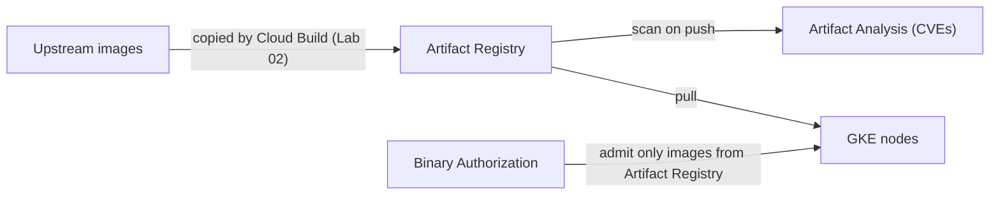

# Security Design for a Production GKE Cluster

GKE security follows a **shared responsibility model**. Google secures the control plane and the underlying infrastructure. You are responsible for how you configure the cluster, its nodes, and the workloads you run. This document walks through the decisions behind the configuration you build in Labs 02-06 and 08.

- [GKE shared responsibility model](https://cloud.google.com/kubernetes-engine/docs/concepts/shared-responsibility)
- [Best practices for hardening your cluster](https://cloud.google.com/kubernetes-engine/docs/how-to/hardening-your-cluster)

## Organization guardrails

The outermost layer of an outside-in design is the **organization**. Organization Policy constraints are set by the organization's administrators, inherited by every folder and project, and enforced on every API request, even for project owners. They stop a risky configuration before it exists, however it is created: console, `gcloud` or Terraform.

The [enterprise foundations blueprint](https://cloud.google.com/architecture/security-foundations/preventative-controls) enforces a baseline of constraints at the organization node. These are the ones that matter most for this platform:

| Constraint | Effect | In this workshop |
|---|---|---|
| `compute.vmExternalIpAccess` | VMs, including GKE nodes, can't have external IP addresses | The cluster uses private nodes (Lab 03) |
| `compute.requireShieldedVm` | Only Shielded VMs can be created | Nodes are Shielded, with Secure Boot (Lab 03) |
| `compute.skipDefaultNetworkCreation` | New projects get no `default` network with its permissive firewall rules | The cluster uses a custom VPC (Lab 02) |
| `iam.disableServiceAccountKeyCreation` | Nobody can create long-lived service account keys | Nothing uses keys: workloads use Workload Identity Federation (Lab 05), people and tools use short-lived tokens |
| `iam.disableServiceAccountKeyUpload` | Nobody can upload external key material to a service account | As above |
| `iam.automaticIamGrantsForDefaultServiceAccounts` | Default service accounts no longer get the Editor role automatically | Nodes and builds use dedicated least-privilege service accounts (Lab 02) |
| `iam.allowedPolicyMemberDomains` | Roles can only be granted to identities of your organization (domain-restricted sharing) | All principals belong to the organization, including the Workload Identity principal in Lab 05 |
| `gcp.resourceLocations` | Resources can only be created in approved locations (data residency) | The allowed values must include your `REGION`, for example `in:asia-southeast1-locations` |
| `gcp.restrictNonCmekServices` | Listed services refuse to create resources without a customer-managed key | Enforces the scope you choose in [Data protection](#data-protection); the workshop's CMEK scope is Kubernetes Secrets only |
| `compute.restrictLoadBalancerCreationForTypes` | Only the listed load balancer types can be created, for example every external type denied except `GLOBAL_EXTERNAL_MANAGED_HTTP_HTTPS` | Platform-level backstop to the quota and the admission policy that stop public `LoadBalancer` Services (Lab 04 and Lab 06, requirement 9) |
| `storage.publicAccessPrevention`, `storage.uniformBucketLevelAccess` | No public Cloud Storage buckets, and IAM-only access to them | The workshop creates no buckets |

GKE publishes **managed constraints** (`container.managed.*`) for its hardening recommendations. The cluster you create in Lab 03 satisfies these:

| Managed constraint | Satisfied by |
|---|---|
| `container.managed.enablePrivateNodes` | `--enable-private-nodes` |
| `container.managed.enableControlPlaneDNSOnlyAccess` | `--enable-dns-access --no-enable-ip-access` |
| `container.managed.disallowDefaultComputeServiceAccount` | `--service-account=${NODE_SA_EMAIL}` |
| `container.managed.enableWorkloadIdentityFederation` | `--workload-pool` |
| `container.managed.enableSecretsEncryption` | `--database-encryption-key` |
| `container.managed.enableBinaryAuthorization` | `--binauthz-evaluation-mode` |
| `container.managed.enableNetworkPolicy` | `--enable-dataplane-v2` |
| `container.managed.enableShieldedNodes` | `--enable-shielded-nodes` |
| `container.managed.disableInsecureKubeletReadOnlyPort` | `--no-enable-insecure-kubelet-readonly-port` |
| `container.managed.enableCloudLogging` | `--logging=...` |
| `container.managed.denyServiceExternalIPs` | The default for clusters created on GKE 1.21 and later |

Two others need preparation. `container.managed.enableSecurityBulletinNotifications` requires the notification configuration when the cluster is created; the workshop adds it later, in Lab 09, so if your organization enforces this constraint, create the Pub/Sub topic first and add Lab 09's `--notification-config` flag to the create command in Lab 03. `container.managed.enableGoogleGroupsRBAC` requires a Google Workspace group for [Google Groups for RBAC](https://cloud.google.com/kubernetes-engine/docs/how-to/google-groups-rbac). For settings without a managed constraint, write [custom constraints](https://cloud.google.com/kubernetes-engine/docs/how-to/custom-org-policies) on GKE cluster and node pool resources, for example to require a release channel.

One managed constraint is **not** satisfied, by design: `container.managed.restrictControlPlaneEgress` requires `--control-plane-egress=NONE`, which is incompatible with Binary Authorization enforcement (see [Control plane protection](#control-plane-protection)). If your organization enforces it, the cluster can't be created as written in Lab 03. Keep the constraint and replace Binary Authorization with a `ValidatingAdmissionPolicy` that allows only images from your Artifact Registry repository (the same CEL mechanism as the Lab 06 guardrails, evaluated inside the API server, so it needs no egress and fails closed), or request an exception for the project. Lab 02 shows which of these constraints apply to your project.

Roll out a new constraint in **dry-run mode** first: violations are logged, but nothing is blocked. Setting organization policies requires the Organization Policy Administrator role on the organization, so workshop participants usually only **read** them. Lab 02 shows the effective policies on your project. The workshop was validated in an organization that enforces `compute.vmExternalIpAccess`, `compute.requireShieldedVm`, `compute.skipDefaultNetworkCreation`, `iam.disableServiceAccountKeyCreation`, `iam.automaticIamGrantsForDefaultServiceAccounts` and `iam.allowedPolicyMemberDomains`.

> [!TIP]
> For regulated customers, add **VPC Service Controls**: a service perimeter around the platform's projects stops data from leaving through Google APIs, even with valid credentials. See [Do you need to stop data exfiltration through Google APIs?](NetworkDesign.md#do-you-need-to-stop-data-exfiltration-through-google-apis) in the network design.

## Identity and access

| Who | Mechanism | Workshop configuration |
|---|---|---|
| People reaching the cluster | **IAM.** The DNS-based endpoint requires `container.clusters.connect`, included in roles such as `roles/container.clusterViewer` and `roles/container.developer`. | DNS-only control plane access (Lab 03) |
| People acting inside the cluster | **Kubernetes RBAC**, per namespace. Prefer groups ([Google Groups for RBAC](https://cloud.google.com/kubernetes-engine/docs/how-to/google-groups-rbac)) over individual users. | `app-developer` Role: can roll out workloads, cannot read Secrets or exec into Pods (Lab 04) |
| Nodes | A dedicated node service account with `roles/container.defaultNodeServiceAccount`, plus read access to the image repository | Lab 02 |
| Build pipelines | A dedicated service account per pipeline, with write access to the image repository only, instead of the broad default build identity | Cloud Build image mirror that may only push images and write logs (Lab 02) |
| Workloads calling Google Cloud APIs | **Workload Identity Federation for GKE.** Grant IAM roles directly to a Kubernetes ServiceAccount principal. No keys. | Secret Manager access for one ServiceAccount (Lab 05) |

Avoid long-lived credentials: no service account keys, no static kubeconfig tokens. Anonymous access to the API server is limited to health check endpoints.

## Node security

- **Container-Optimized OS**: minimal, read-only root file system, maintained by Google.
- **Shielded GKE nodes with Secure Boot and integrity monitoring**: verifiable node identity and a signed boot chain.
- **No external IPs** (private nodes) and the **kubelet read-only port disabled**.
- **Automatic upgrades and repair**, with security patches applied as soon as they are available (accelerated patch updates).
- Optional: **GKE Sandbox** (gVisor) for untrusted code, and **Confidential GKE Nodes** for memory encryption.

## Control plane protection

- **DNS-based endpoint only**: no IP endpoints to scan or attack. Optionally add VPC Service Controls.
- **Control plane egress stays open, on purpose.** GKE can block all outbound traffic from the API server (`--control-plane-egress=NONE`), which stops admission webhooks from sending data to external URLs. But it also blocks the API server's calls to Google APIs, and GKE enforces Binary Authorization through a webhook that calls the Binary Authorization service with `failurePolicy: Ignore`. With egress blocked, the webhook times out, every image is admitted, and the only trace is a `failed-open.validating.webhook.admission.k8s.io` label in the audit log (Lab 04, step 6, and Lab 10). Binary Authorization is the stronger control for this design, so the cluster keeps the default egress mode (`VIA_CONTROL_PLANE`). Inbound access is a separate setting and stays DNS-only. Pick `NONE` only for clusters that don't enforce Binary Authorization.
- **Audit logging**: every change through the Kubernetes and GKE APIs is recorded. See [Audit logging](#audit-logging).

## Software supply chain

- **One approved registry**: Artifact Registry. Nodes can't reach other registries anyway, because egress is locked down.
- **Vulnerability scanning**: Artifact Analysis scans images on push and keeps re-analyzing them as new CVEs are published.
- **Deploy-time enforcement**: Binary Authorization admits only images from the approved repository. Google-maintained system images are exempt. A break-glass label exists for emergencies and is always audited.
- **Immutable, pinned tags**: the repository uses immutable tags, and an admission policy rejects `:latest`.

## Admission control (guardrails)

| Layer | Tool | Example |
|---|---|---|
| Pod security | **Pod Security Admission** (built into Kubernetes) | Enforce `restricted`: no privileged containers, non-root users, dropped capabilities, seccomp |
| Custom rules | **ValidatingAdmissionPolicy** (CEL, built into Kubernetes 1.30+) | No `:latest` images, resource requests required, no public LoadBalancer Services |
| Policy libraries and compliance | **Policy Controller** (managed OPA Gatekeeper, included with GKE) | CIS and Pod Security bundles, audit and dashboard |
| Organization-wide | **Organization Policy** with GKE managed constraints | See [Organization guardrails](#organization-guardrails) |

## Data protection

- Google encrypts all data at rest by default. **Application-layer secrets encryption** additionally encrypts Kubernetes Secrets in etcd with a **customer-managed Cloud KMS key** (Lab 02 and Lab 03).
- Keep secrets **outside** the cluster in Secret Manager. See [Secret Management](SecretManagement.md).
- Encrypt in transit: TLS at the load balancer with a modern SSL policy. Dataplane V2 also offers optional inter-node transparent encryption, which is not compatible with FQDN network policies.

**Scope of customer-managed keys (CMEK).** Requirement 8 asks for a customer-managed key for Kubernetes Secrets, which is what the workshop builds. Every other store uses Google-managed keys. If your regulator requires CMEK more widely, each store has its own switch, and the `gcp.restrictNonCmekServices` organization policy ([above](#organization-guardrails)) turns the choice into a rule that creation requests can't skip:

| Data at rest | In this workshop | CMEK option |
|---|---|---|
| Kubernetes Secrets in etcd | **Customer-managed key** | Done (`--database-encryption-key`) |
| Node boot disks | Google-managed | `--boot-disk-kms-key` at cluster or node pool creation; grant the Compute Engine service agent on the key |
| PersistentVolumes | Google-managed | StorageClass parameter `disk-encryption-kms-key` |
| Artifact Registry repository | Google-managed | `--kms-key` at repository creation; grant the Artifact Registry service agent on the key |
| Secret Manager secret | Google-managed | `--kms-key-name` |
| Backup for GKE | Google-managed | CMEK on the backup plan |
| Audit log bucket | Google-managed | `--cmek-kms-key-name` (noted in Lab 08) |
| Control plane disks and etcd | Google-managed | Only through [GKE Control Plane Authority](https://cloud.google.com/kubernetes-engine/docs/how-to/encrypt-etcd-control-plane-disks), opt-in via your account team; `asia-southeast1` is supported |

Adding the boot-disk and Artifact Registry keys to Lab 02 and Lab 03 is a small change, but it needs the two service agents granted on the key and a fresh validation run, so the workshop leaves it as an exercise.

## Audit logging

Cloud Audit Logs answer "who did what, where and when" for Google Cloud APIs and for the Kubernetes API of your cluster (service name `k8s.io`):

| Audit log type | Records, for example | Enabled | Stored |
|---|---|---|---|
| Admin Activity | Creating the cluster, changing a firewall policy, `kubectl apply`, `kubectl exec` | Always; can't be disabled | `_Required` bucket: 400 days, free, nobody can change or delete it |
| System Event | Actions by Google systems, such as node auto-repair | Always | `_Required` bucket |
| Policy Denied | Requests denied by VPC Service Controls or an organization policy | Always (can be excluded) | `_Default` bucket: 30 days |
| Data Access | Reading configuration or data: who read a secret's value, who used a KMS key, `kubectl get` | **Disabled by default** (except BigQuery) | `_Default` bucket: 30 days |

Recommendations for production:

- **Enable Data Access audit logs where sensitive data lives.** They can be high-volume and are billed like other logs, so the enterprise foundations blueprint leaves them off by default and asks you to decide per service and environment. The workshop enables them for Secret Manager, Cloud KMS and the Kubernetes Engine API. The last one matters for Kubernetes Secrets: GKE's [audit policy](https://cloud.google.com/kubernetes-engine/docs/concepts/audit-policy) sends `get`, `list` and `watch` on the Kubernetes API to the Data Access log, so without it a `kubectl get secret` leaves no trace. It is also the most voluminous of the three.
- **Centralize.** An organization-level **aggregated sink** routes the audit logs of every project to a dedicated logging project. Only the security team can access it, so project owners and administrators can't tamper with their own audit trail. Data Access logs can contain sensitive details: anyone who can read a log bucket can read the Data Access logs in it.
- **Retain and protect.** Keep the logs as long as regulation requires, in a **locked** log bucket (up to 10 years; nobody can then shorten the retention or delete the bucket) or a Cloud Storage bucket with Bucket Lock for longer archives. Add customer-managed encryption keys if required, Log Analytics or BigQuery for investigations, and Pub/Sub to feed your SIEM.
- **Alert** on suspicious activity, such as `kubectl exec` in production (Lab 08).

In Lab 08 you enable Data Access audit logs, prove that the Admin Activity logs can't be deleted, and route all audit logs to a dedicated log bucket in your project. Because locking a bucket is irreversible, the workshop only shows the lock command.

## Detection and response

- **Cloud Logging**: system, workload and control plane logs; audit logs; firewall, NAT, network policy and load balancer logs.
- **Alerting**: for example, alert when someone runs `kubectl exec` in production, or when the WAF blocks an attack (Lab 08).
- **GKE security posture dashboard**: continuous workload configuration audit and security bulletins.
- **Security Command Center** (optional): threat detection, vulnerability findings and posture management across the organization.

## Next Steps

[Back to Cluster Design](README.md)

## Key Links

- [GKE security overview](https://cloud.google.com/kubernetes-engine/docs/concepts/security-overview)
- [Workload Identity Federation for GKE](https://cloud.google.com/kubernetes-engine/docs/concepts/workload-identity)
- [Binary Authorization](https://cloud.google.com/binary-authorization/docs/overview)
- [Pod Security Admission](https://kubernetes.io/docs/concepts/security/pod-security-admission/)
- [ValidatingAdmissionPolicy](https://kubernetes.io/docs/reference/access-authn-authz/validating-admission-policy/)
- [Organization policy constraints](https://cloud.google.com/resource-manager/docs/organization-policy/org-policy-constraints), including the GKE managed constraints (`container.managed.*`), the [load balancer constraints](https://cloud.google.com/load-balancing/docs/org-policy-constraints) and [`gcp.restrictNonCmekServices`](https://cloud.google.com/kms/docs/cmek-org-policy)
- [Using CMEK in GKE](https://cloud.google.com/kubernetes-engine/docs/how-to/using-cmek) and [GKE Control Plane Authority](https://cloud.google.com/kubernetes-engine/docs/how-to/encrypt-etcd-control-plane-disks)
- Enterprise foundations blueprint: [preventative controls](https://cloud.google.com/architecture/security-foundations/preventative-controls) and [centralized logging](https://cloud.google.com/architecture/security-foundations/detective-controls)
- [Cloud Audit Logs overview](https://cloud.google.com/logging/docs/audit), [enable Data Access audit logs](https://cloud.google.com/logging/docs/audit/configure-data-access) and [aggregated sinks](https://cloud.google.com/logging/docs/export/aggregated_sinks)
