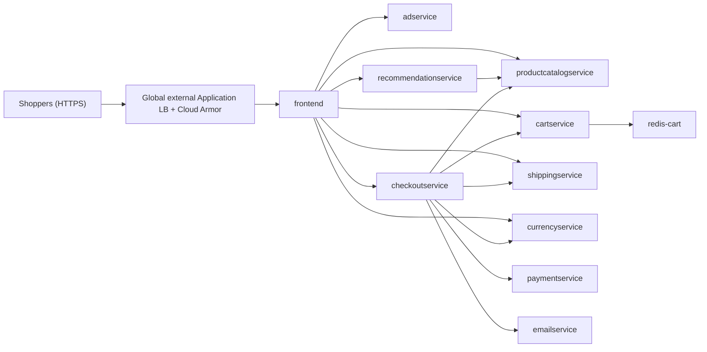
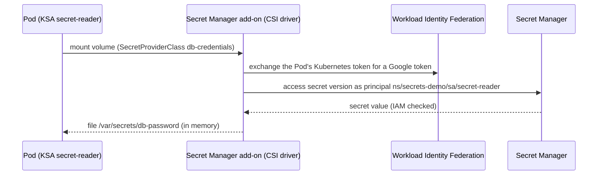

# Lab 05 - Deploy the Application

The platform is ready. Now you work as the **application team**: deploy the [Online Boutique](https://github.com/GoogleCloudPlatform/microservices-demo) sample application, publish it through the shared Gateway (with the Cloud Armor WAF), and give it a secret from Secret Manager without storing it in Kubernetes.

Online Boutique is a cloud-native e-commerce app made of 11 microservices written in Go, C#, Node.js, Python and Java, plus Redis. One of the 11, `loadgenerator`, simulates shoppers; it isn't deployed here, only in Lab 07, while that lab needs traffic:



**Estimated time:** 60 minutes

> [!NOTE]
> Run `source ./env.sh` first if you opened a new Cloud Shell session.

## 1. Review the deployment

You don't edit the upstream manifests. [`upstream/kubernetes-manifests.yaml`](online-boutique/upstream/kubernetes-manifests.yaml) is an unmodified copy of the `v0.10.7` release. Every production change is a **Kustomize overlay** in [`kustomization.yaml.tmpl`](online-boutique/kustomization.yaml.tmpl):

| Change | Why |
|---|---|
| Delete the `frontend-external` Service | Upstream exposes the frontend with an L4 `LoadBalancer` Service (public IP, no TLS, no WAF). The `onlineboutique` quota allows zero LoadBalancer Services anyway. |
| Delete the `loadgenerator` Deployment and ServiceAccount | Upstream runs simulated shoppers around the clock. That load would fill the logs and keep CPU busy for the rest of the workshop. Lab 07 starts it from [`loadgenerator.yaml`](../07-cost-governance/manifests/loadgenerator.yaml) when it needs traffic, and deletes it again afterwards. |
| Add `seccompProfile: RuntimeDefault` to every Pod | Required by the **restricted** Pod Security Standard that the namespace enforces. Upstream already runs as non-root, drops all capabilities and uses a read-only root file system. |
| Rewrite every image to `${AR_PATH}` | The cluster pulls only from your Artifact Registry (egress is locked down, and Binary Authorization will require it in Lab 06) |
| Add a 20-second `preStop` sleep to the frontend | **Graceful shutdown** behind the load balancer. When a frontend Pod is stopped (rollout, node drain), it keeps serving while the load balancer removes it from the backends, so users don't see errors. Lab 09 puts this to the test. |
| Add topology spread constraints to every Deployment | **Zone redundancy.** A regional cluster has nodes in three zones, but a service only survives a zone outage if its replicas run in more than one zone. The scheduler's built-in spreading is only a soft preference, so the overlay requires each service's replicas to be spread across zones (`DoNotSchedule`) and prefers different nodes (`ScheduleAnyway`). Lab 09 scales the services to two replicas and checks the spread. |
| Add [`network-policies.yaml`](online-boutique/network-policies.yaml) | Opens only what the app needs on top of the namespace's default-deny: Pod-to-Pod traffic inside `onlineboutique`, and load balancer traffic to the frontend (from Google's ranges `35.191.0.0/16` and `130.211.0.0/22` on port 8080) |
| Add [`gateway-route.yaml`](online-boutique/gateway-route.yaml) | `HTTPRoute`: attaches the frontend to the shared Gateway's HTTPS listener.<br>`HealthCheckPolicy`: the load balancer checks `/_healthz`.<br>`GCPBackendPolicy`: attaches the Cloud Armor policy, keeps access logs on and enables connection draining. |

## 2. Deploy Online Boutique

Render the overlay with your values. Only the three listed variables are substituted, so the upstream manifests stay untouched.

```bash
envsubst '${AR_PATH} ${OB_VERSION} ${ARMOR_POLICY}' \
  < 05-deploy-app/online-boutique/kustomization.yaml.tmpl \
  > 05-deploy-app/online-boutique/kustomization.yaml
```

Preview what will be applied, then apply it:

```bash
kubectl kustomize 05-deploy-app/online-boutique | grep -E "^kind:|image:" | sort | uniq -c
```

```bash
kubectl apply -k 05-deploy-app/online-boutique
```

Wait until every Deployment is available (2-3 minutes):

```bash
kubectl wait deployment --all -n onlineboutique --for=condition=Available --timeout=10m
kubectl get pods -n onlineboutique -o wide
```

No Pod Security warnings are printed, and every Pod runs from your registry:

```bash
kubectl get pods -n onlineboutique -o jsonpath='{range .items[*]}{.spec.containers[0].image}{"\n"}{end}' | sort -u
```

Every Deployment also carries the two topology spread constraints, for example the frontend:

```bash
kubectl get deployment frontend -n onlineboutique \
  -o jsonpath='{range .spec.template.spec.topologySpreadConstraints[*]}{.topologyKey}{"  "}{.whenUnsatisfiable}{"\n"}{end}'
```

```text
topology.kubernetes.io/zone  DoNotSchedule
kubernetes.io/hostname  ScheduleAnyway
```

## 3. Publish the storefront through the Gateway

Check that the platform team's Gateway **accepted** your route. The namespace has the `gateway-access: "true"` label, so the HTTPS listener allows it:

```bash
kubectl get httproute frontend -n onlineboutique \
  -o jsonpath='{range .status.parents[*].conditions[*]}{.type}={.status} ({.reason}){"\n"}{end}'
```

```text
Accepted=True (Accepted)
ResolvedRefs=True (ResolvedRefs)
```

The GKE Gateway controller now creates a backend service with **network endpoint groups (NEGs)** that point directly at the frontend Pod IPs (container-native load balancing), plus a health check, and attaches the Cloud Armor policy. From here on, a request crosses nine controls between the browser and the `frontend` container; the [ingress flow](../01-cluster-design/IngressFlow.md) page shows every one of them, which object configures it, and where its evidence is. Wait until the storefront answers 5 times in a row. This usually takes 3-10 minutes:

```bash
OK=0
for i in $(seq 1 120); do
  CODE="$(curl -sk -o /dev/null -w '%{http_code}' "https://${GATEWAY_IP}/" || true)"
  if [ "${CODE}" = "200" ]; then OK=$((OK + 1)); else OK=0; echo "Waiting for the storefront (HTTPS ${CODE})..."; sleep 10; fi
  if [ "${OK}" -ge 5 ]; then echo "The storefront is up."; break; fi
done
curl -sk "https://${GATEWAY_IP}/" | tr -s ' \n' ' ' | grep -o "<title>[^<]*</title>"
```

```text
The storefront is up.
<title> Online Boutique </title>
```

Because the certificate is self-signed, `curl -k` skips verification. To verify the certificate properly, trust **your** certificate explicitly and use the host name it was issued for:

```bash
curl -sS -o /dev/null -w "HTTPS %{http_code} - certificate verified for ${APP_HOST}\n" \
  --cacert tls/tls.crt \
  --resolve "${APP_HOST}:443:${GATEWAY_IP}" \
  "https://${APP_HOST}/"
```

Open the shop in your browser. Expect a certificate warning (self-signed); continue to the site.

```bash
echo "https://${GATEWAY_IP}"
```


Confirm that the backend service created by the Gateway has your Cloud Armor policy attached:

```bash
gcloud compute backend-services list \
  --filter="securityPolicy:${ARMOR_POLICY}" \
  --format="table(name,securityPolicy.basename():label=SECURITY_POLICY,protocol)"
```

> [!NOTE]
> The WAF rules are still in **preview** mode: attacks are logged but not blocked. You switch them to enforcement in Lab 06.

## 4. Use Secret Manager with Workload Identity

Applications need credentials, such as a database password. Environment variables and Kubernetes Secrets keep them inside the cluster, where anyone who can create Pods in the namespace can read them (see [Secret Management](../01-cluster-design/SecretManagement.md)). On GKE, credentials live in **Secret Manager**, accessed through **Workload Identity Federation for GKE**, and mounted into Pods by the **Secret Manager add-on** (enabled at cluster creation).

The flow involves no keys and no Kubernetes Secret object:



Create the secret, stored only in your region:

```bash
printf 'S3cure-P@ssw0rd-v1' | gcloud secrets create "${PREFIX}-db-password" \
  --replication-policy=user-managed \
  --locations="${REGION}" \
  --data-file=-
```

Grant **one** Kubernetes ServiceAccount (`secret-reader` in namespace `secrets-demo`) access to **this** secret. The member is a Workload Identity Federation principal; no Google service account is involved:

```bash
gcloud secrets add-iam-policy-binding "${PREFIX}-db-password" \
  --role="roles/secretmanager.secretAccessor" \
  --member="principal://iam.googleapis.com/projects/${PROJECT_NUMBER}/locations/global/workloadIdentityPools/${PROJECT_ID}.svc.id.goog/subject/ns/secrets-demo/sa/secret-reader" \
  --format=none
```

Deploy the ServiceAccount, the `SecretProviderClass` (which secret to mount, and as which file) and a small app that mounts it. Review [`secret-reader.yaml`](secrets-demo/secret-reader.yaml) first:

```bash
envsubst '${PROJECT_ID} ${PREFIX} ${AR_PATH}' < 05-deploy-app/secrets-demo/secret-reader.yaml | kubectl apply -f -
kubectl rollout status deployment/secret-reader -n secrets-demo --timeout=180s
```

Read the mounted secret. In real life, your application reads this file:

```bash
kubectl exec -n secrets-demo deploy/secret-reader -- cat /var/secrets/db-password; echo
```

The app only logs a fingerprint of the value, never the value itself:

```bash
kubectl logs -n secrets-demo deploy/secret-reader --tail=2
```

### Negative test: an identity without access

[`unauthorized-reader.yaml`](secrets-demo/unauthorized-reader.yaml) uses the same `SecretProviderClass` but runs as the namespace's `default` ServiceAccount, which has no IAM binding:

```bash
envsubst '${AR_PATH}' < 05-deploy-app/secrets-demo/unauthorized-reader.yaml | kubectl apply -f -
sleep 45
kubectl get pod unauthorized-reader -n secrets-demo
```

The Pod is stuck in `ContainerCreating`. The `FailedMount` event shows why. Its message is long; this extracts the important part:

```bash
kubectl get events -n secrets-demo --field-selector involvedObject.name=unauthorized-reader,reason=FailedMount \
  -o jsonpath='{.items[0].message}' | grep -o "code = PermissionDenied desc = Permission '[^']*' denied"
```

```text
code = PermissionDenied desc = Permission 'secretmanager.versions.access' denied
```

The Secret Manager add-on requested the secret **as the Pod's own identity** (`ns/secrets-demo/sa/default`), and IAM refused because only `secret-reader` was granted access.

```bash
kubectl delete pod unauthorized-reader -n secrets-demo
```

### Rotate the secret

Add a new secret version. Because the add-on was enabled with rotation, mounted files are refreshed automatically (every 2 minutes by default) without restarting the Pod:

```bash
printf 'S3cure-P@ssw0rd-v2' | gcloud secrets versions add "${PREFIX}-db-password" --data-file=-
```

```bash
for i in $(seq 1 16); do
  VALUE="$(kubectl exec -n secrets-demo deploy/secret-reader -- cat /var/secrets/db-password)"
  if [ "${VALUE}" = "S3cure-P@ssw0rd-v2" ]; then echo "Rotated value is mounted."; break; fi
  echo "Still the old value, waiting for the rotation interval..."; sleep 15
done
sleep 30   # the app logs a fingerprint every 30 seconds
kubectl logs -n secrets-demo deploy/secret-reader --tail=8
```

The logged fingerprint changes after the rotation. The Pod was never restarted:

```bash
kubectl get pods -n secrets-demo -l app=secret-reader
```

> [!TIP]
> Applications can also call the Secret Manager API directly with the Google Cloud client libraries. Workload Identity Federation provides the credentials automatically. The [hardening guide](https://cloud.google.com/kubernetes-engine/docs/how-to/hardening-your-cluster#store_secrets_outside_your_cluster) prefers this approach; the add-on is ideal when you can't change the application code.

## 5. Roll out a new version

Deployments perform rolling updates with no downtime. Change the frontend's configuration (a banner message) and watch the rollout:

```bash
kubectl set env deployment/frontend -n onlineboutique FRONTEND_MESSAGE="Welcome to the production GKE workshop!"
kubectl rollout status deployment/frontend -n onlineboutique --timeout=180s
```

When the rollout completes, the old Pod still serves for up to 20 seconds (its `preStop` sleep) while the load balancer stops sending it requests. Wait until 5 requests in a row get the new version:

```bash
OK=0
for i in $(seq 1 60); do
  PAGE="$(curl -sk "https://${GATEWAY_IP}/" || true)"
  if [[ "${PAGE}" == *"Welcome to the production GKE workshop!"* ]]; then OK=$((OK + 1)); else OK=0; echo "Waiting for the new version..."; sleep 5; fi
  if [ "${OK}" -ge 5 ]; then echo "The new version is live."; break; fi
done
kubectl rollout history deployment/frontend -n onlineboutique
```

Something went wrong? Roll back to the previous revision:

```bash
kubectl rollout undo deployment/frontend -n onlineboutique
kubectl rollout status deployment/frontend -n onlineboutique --timeout=180s
```

> [!NOTE]
> `kubectl set env` is used here for speed. In a real delivery pipeline you would change the manifest in Git and let your CD tool apply it, so the cluster never drifts from source control.

## 6. Checkpoint

```bash
kubectl get deploy,svc,httproute -n onlineboutique
```

The storefront is live on HTTPS through the global load balancer with the WAF attached. It runs only images from your registry, with restricted Pod Security and default-deny networking, and a secret is served from Secret Manager to exactly one identity.

## Next Steps

[Lab 06 - Cluster Security](../06-cluster-security/README.md)

## Key Links

- [Online Boutique](https://github.com/GoogleCloudPlatform/microservices-demo)
- [Container-native load balancing](https://cloud.google.com/kubernetes-engine/docs/concepts/container-native-load-balancing)
- [Configure Gateway resources using policies](https://cloud.google.com/kubernetes-engine/docs/how-to/configure-gateway-resources)
- [Use Secret Manager add-on with GKE](https://cloud.google.com/secret-manager/docs/secret-manager-managed-csi-component)
- [Workload Identity Federation for GKE](https://cloud.google.com/kubernetes-engine/docs/concepts/workload-identity)
- [Performing a rolling update](https://kubernetes.io/docs/tutorials/kubernetes-basics/update/update-intro/)
