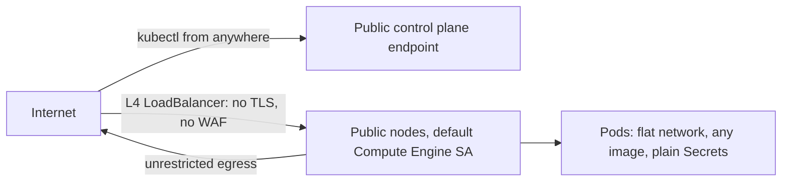
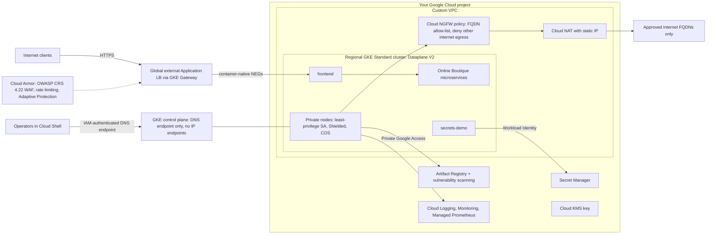

# Production GKE Workshop

Hello, and welcome to the workshop. This is a **2-day, hands-on workshop** in which you build a **production-grade Google Kubernetes Engine (GKE) cluster from scratch**, following Google Cloud's current best practices, so it meets the governance, security and operational needs of a highly regulated customer.

The workshop takes an **outside-in** approach. It starts with the design decisions that must be made before any resource exists. Then it builds the environment the cluster lives in (network, egress controls, identities, encryption keys, registry), creates a hardened cluster, and adds the platform baseline that application teams rely on. On Day 2 you deploy a real microservices application, prove every security control by trying to break it, and then turn to Day-2 operations: cost governance, observability, upgrades, and backup and restore.

Every step is a command you run yourself in Cloud Shell. Each lab explains **why** each setting matters, not just **how** to apply it.

## End Goal

The end goal is to take you from a GKE setup that is open by default to an enterprise-ready configuration that is secure by default.

### Before: a default "quick-start" cluster



### After: what you build in this workshop



## Customer Requirements

The workshop is driven by the requirements of a regulated customer. [Lab 10](10-validate-scenarios/README.md) validates each one.

1. Use the existing identity system; no static credentials for people, nodes or workloads.
2. Apply the principle of least privilege everywhere.
3. Nothing is reachable from the internet except the published application: private nodes, private control plane.
4. Egress is limited to an approved list of destinations; everything else is blocked and logged.
5. The application is protected by TLS, a web application firewall and rate limiting.
6. Teams and environments are isolated from each other on the network.
7. Only approved images from the company registry can run, and images are scanned for vulnerabilities.
8. Secrets live outside the cluster; Kubernetes Secrets are encrypted with a customer-managed key.
9. Guardrails prevent insecure workloads (privileged Pods, `:latest` images, public load balancers).
10. Everything is logged for audit, with alerts on suspicious activity (for example a shell in a container, or web attacks).
11. Costs are visible per team (chargeback), and resources are right-sized.
12. Upgrades are controlled and cause no downtime; workloads can be backed up and restored.

## Lab Guides - Day 1

1. [Cluster Design](01-cluster-design/README.md) (discussion)
2. [Cluster Pre-Provisioning](02-cluster-pre-provisioning/README.md): VPC, Cloud NAT, egress firewall, least-privilege service accounts, KMS, Artifact Registry
3. [Cluster Provisioning](03-cluster-provisioning/README.md): the hardened cluster, flag by flag
4. [Post-Provisioning](04-cluster-post-provisioning/README.md): platform baseline, egress tests, Cloud Armor, TLS, shared Gateway

## Lab Guides - Day 2

5. [Deploy the Application](05-deploy-app/README.md): Online Boutique spread across zones, Gateway route, Secret Manager with Workload Identity
6. [Cluster Security](06-cluster-security/README.md): Pod Security, admission policies, Binary Authorization, network policies, WAF, image scanning
7. [Cost Governance](07-cost-governance/README.md)
8. [Cluster Monitoring](08-cluster-monitoring/README.md): logs, metrics, alerting, Hubble, audit logging
9. [Day-2 Operations](09-day2-operations/README.md): upgrades, maintenance, zone-redundant replicas and PDBs, node pool migration, Backup for GKE
10. [Validate Scenarios](10-validate-scenarios/README.md)

When you are done: [Cleanup](99-cleanup/README.md). Prefer Infrastructure as Code? See the [Terraform appendix](appendix-terraform/README.md).

Want a harder format? Try the [customer challenges](CUSTOMER_CHALLENGES.md).

## Prerequisites

The following are the requirements to **start**:

- A **Google Cloud project** with billing enabled, in which you have the **Owner** role. Use a dedicated sandbox project; the cleanup lab can delete everything.
- **Cloud Shell** ([open it](https://shell.cloud.google.com/)). It comes with every tool the workshop needs: `gcloud`, `kubectl` (the version matching your cluster is selected automatically), `gke-gcloud-auth-plugin`, `openssl`, `envsubst`, `git`, `curl` and `jq`.
- Enough **regional quota** in the chosen region (default `asia-southeast1`): at least 32 E2 vCPUs, 400 GB of SSD and 2 static IP addresses. Lab 02 checks this for you.
- A modern web browser.

> [!WARNING]
> **Cost.** The workshop creates billable resources: a regional GKE cluster ($0.10 per hour cluster fee) with three `e2-standard-4` nodes, a global load balancer, Cloud NAT, Cloud Armor, Binary Authorization, Artifact Analysis scans, and log and metric ingestion. Expect a few tens of US dollars per participant for two days. [PRICING.md](PRICING.md) lists every charge and its pricing model; use the [pricing calculator](https://cloud.google.com/products/calculator) for exact numbers. Run the [cleanup](99-cleanup/README.md) at the end, and consider a [budget alert](https://cloud.google.com/billing/docs/how-to/budgets).

## Getting Started

In Cloud Shell, clone the repository and set your project in `env.sh`:

```bash
git clone https://github.com/<your-org>/gke-production-cluster.git
cd gke-production-cluster
sed -i 's/REPLACE_WITH_YOUR_PROJECT_ID/<your-project-id>/' env.sh   # or edit env.sh with: cloudshell edit env.sh
source ./env.sh
```

Every lab assumes you are in the repository root and have run `source ./env.sh` in the current shell session. Then start with [Lab 01 - Cluster Design](01-cluster-design/README.md).

## Before You Commit

Running the labs writes your project ID into `env.sh` and into files the labs render (`envsubst` output in `05-deploy-app/online-boutique/kustomization.yaml` and `**/rendered/`, the private key in `tls/`, Terraform inputs and state). The rendered files are ignored by git; `env.sh` is not. Before you commit, and before you publish a fork, run [`scripts/sanitize.sh`](scripts/sanitize.sh):

```bash
./scripts/sanitize.sh --check   # report only: exit 1 if anything would leak
./scripts/sanitize.sh           # reset env.sh to the defaults (your values go to env.sh.local), fix .gitignore
./scripts/sanitize.sh --purge   # the same, plus delete the rendered manifests
```

It also scans every file git would commit for project IDs, project numbers, e-mail addresses, public IP addresses, private keys, Google credentials and cluster-generated resource names, which is what pasted command output tends to contain. To run the check automatically:

```bash
printf '#!/usr/bin/env bash\nexec ./scripts/sanitize.sh --check\n' > .git/hooks/pre-commit && chmod +x .git/hooks/pre-commit
```

After committing, `cp env.sh.local env.sh` brings your values back.

## Troubleshooting

| Symptom | Fix |
|---|---|
| Variables are empty (for example `--location=""`) after Cloud Shell reconnects | Cloud Shell sessions don't keep shell variables. Run `cd ~/gke-production-cluster && source ./env.sh` again. |
| `kubectl` reports `error: You must be logged in to the server (the server has asked for the client to provide credentials)`, while `gcloud` commands still work | The GKE auth plugin cached an access token that is no longer valid, for example after Cloud Shell re-authorized your session. Delete the cache and retry: `rm -f ~/.kube/gke_gcloud_auth_plugin_cache` |
| A command fails with a quota error | Check the quotas with `./scripts/check-prereqs.sh`, or choose another region in `env.sh` before Lab 02 |
| `./scripts/mirror-images.sh` (Lab 02) stops with `the build failed 3 times` | Open the build's logs link that the script printed. A `denied` error on push means the image mirror service account lacks its roles from Lab 02, step 10: check them and run the script again. An organization policy error, for example about `constraints/cloudbuild.allowedWorkerPools`, means your organization restricts Cloud Build; ask your administrator to allow it in the workshop project. |

## Validated Versions

The labs were last validated end to end on **2026-10-23** with the versions below. Since then, Lab 03 dropped `--control-plane-egress=NONE` (it made the Binary Authorization check in Lab 06 fail open), Lab 04 step 6 and the Lab 06 break-glass text changed accordingly, and the load generator moved from Lab 05 to Lab 07. Those changes have not yet been validated on a fresh cluster.

| Component | Version |
|---|---|
| GKE | 1.36.4-gke.1495002 (Regular release channel), GKE Standard, regional, `asia-southeast1` |
| Google Cloud CLI | 587.0.0 (Cloud Shell) |
| Online Boutique | v0.10.7 |
| Cloud Armor WAF rules | OWASP CRS 4.22 (`*-v422-stable`) |
| Gateway API | Standard channel, as installed by GKE |
| Terraform (optional appendix) | Terraform 1.16.6, `hashicorp/google` and `hashicorp/google-beta` 8.7.0 |

GKE evolves quickly. If a command behaves differently, check the [GKE release notes](https://cloud.google.com/kubernetes-engine/docs/release-notes).

## Repository Layout

```text
.
├── env.sh                         # all variables (edit PROJECT_ID / PREFIX / REGION)
├── 01-cluster-design/             # design discussion (network, security, secrets)
├── 02-cluster-pre-provisioning/   # VPC, NAT, firewall policy, IAM, KMS, Artifact Registry
├── 03-cluster-provisioning/       # hardened cluster creation
├── 04-cluster-post-provisioning/  # baseline, egress tests, Cloud Armor, TLS, Gateway
├── cluster-config/                # Kubernetes baseline (namespaces, PSA, quotas, RBAC, network policies)
├── 05-deploy-app/                 # Online Boutique overlay, Secret Manager demo
├── 06-cluster-security/           # admission policies, Binary Authorization, FQDN policy, WAF tests
├── 07-cost-governance/            # cost allocation, VPA, HPA, Spot
├── 08-cluster-monitoring/         # logs, metrics, PromQL, alerting
├── 09-day2-operations/            # upgrades, maintenance, node pool migration, backup and restore
├── 10-validate-scenarios/         # requirements-to-technology matrix
├── 99-cleanup/                    # teardown
├── appendix-terraform/            # optional Terraform version of Labs 02-03
└── scripts/                       # check-prereqs.sh, mirror-images.sh, show-zone-spread.sh, sanitize.sh
```

## Acknowledgements

- The sample application is [Online Boutique](https://github.com/GoogleCloudPlatform/microservices-demo) by Google LLC, licensed under the Apache License 2.0. An unmodified copy of its release manifest is included in [`05-deploy-app/online-boutique/upstream`](05-deploy-app/online-boutique/upstream).

## License

Licensed under the [Apache License, Version 2.0](LICENSE).
